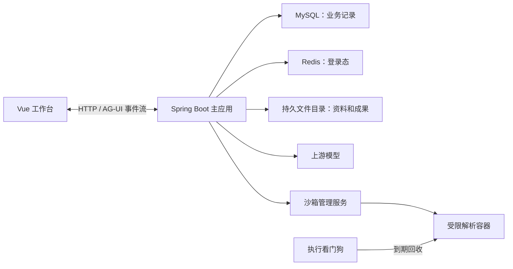

# iWork 项目架构

## 项目架构

主应用是一个按业务分包的 Java 21 / Spring Boot 单体。Vue 3 工作台使用 TypeScript 和 Vite，交付时静态文件随 Spring Boot JAR 一起打包。主应用负责身份校验、任务调度、智能体执行、模型用量和成果发布。单机 Docker Compose 另外运行 MySQL、Redis、沙箱管理服务和执行看门狗。

### 一次任务怎样执行

1. 工作台通过 `POST /api/conversations/{id}/ag-ui` 提交工作请求。后端在 MySQL 记录任务，以用户和请求 ID 去重，同一会话最多有一个运行中的任务。任务由主应用立即执行或从 MySQL 队列调度。
2. 主应用用 AgentScope Java 的 `HarnessAgent` 执行任务。模型调用统一检查授权、预占额度并记录用量，摘要调用也走这条路径。需要解析资料时，固定业务工具通过内部网络请求沙箱管理服务启动受限解析容器。管理服务和无网络的执行看门狗持有 Docker socket，主应用通过管理接口操作。看门狗按容器创建时间执行到期回收。
3. 工作台拿到任务 ID 后，通过 `GET /api/tasks/{id}/ag-ui` 订阅 SSE（服务端事件流），接收回复和工具进度。关闭页面或断线后，任务继续执行。刷新页面会重新订阅同一个任务，取回当前回复快照并接收后续更新。生成中的回复保存在主应用内存中，重启后会丢失尚未落库的部分，运行中的任务会被标为中断。
4. 文档任务先用 `prepare_document` 保存草稿。任务成功时，主应用先写好正式文件，再在同一数据库事务中登记成果版本、保存助手回复并标记任务完成。发布前会锁定任务并检查它仍在运行，避免取消后到达的结果被发布。

入口代码见 [TaskController](../backend/src/main/java/io/iwork/conversation/TaskController.java)、[TaskService](../backend/src/main/java/io/iwork/conversation/TaskService.java)、[HarnessTaskRunner](../backend/src/main/java/io/iwork/agent/HarnessTaskRunner.java) 和 [DocumentService](../backend/src/main/java/io/iwork/artifacts/DocumentService.java)。

## 目录结构

| 路径 | 内容 |
| --- | --- |
| [`frontend/src/`](../frontend/src/) | Vue 工作台。`App.vue` 是页面外壳，`router.ts` 定义路由，`api.ts` 和 `agUi.ts` 处理业务请求和任务提交。功能面板及其单元测试放在同一目录。 |
| [`frontend/e2e/`](../frontend/e2e/) | Playwright 端到端测试，覆盖工作台流程和流式回复。 |
| [`backend/src/main/java/io/iwork/`](../backend/src/main/java/io/iwork/) | 正式后端，`IWorkApplication.java` 是启动入口。 |
| [`backend/src/main/resources/`](../backend/src/main/resources/) | Spring Boot 配置和 Flyway 数据库迁移。 |
| [`backend/src/test/`](../backend/src/test/) | Java 测试与测试替身。 |
| [`sandbox/`](../sandbox/) | Python 文本解析器、处理容器镜像定义和沙箱验证脚本。沙箱管理服务与执行看门狗共用后端的 `SandboxControl` 入口。 |
| [`scripts/`](../scripts/) | 本地开发、部署验证、备份与恢复脚本。 |
| [`prototypes/`](../prototypes/) | 独立运行的架构验证原型。 |
| [`docs/`](./) | 项目规范与工程指南。`brand/` 保存品牌素材，`validation/` 保存验收截图。 |
| [`Dockerfile`](../Dockerfile)、[`compose.yaml`](../compose.yaml) | 构建与单机编排。`compose.dev.yaml` 启动本地开发依赖，`compose.release.yaml` 覆盖交付镜像。 |
| [`openapi.yaml`](../openapi.yaml) | 业务 API 契约。更新方法见 [开发指南](DEVELOPMENT.md#更新-openapi)。 |

后端的业务包位于 `backend/src/main/java/io/iwork/`。

| 包 | 职责 |
| --- | --- |
| `identity` | 登录、账号管理、当前调用者校验和业务 API 响应。 |
| `conversation` | 会话、项目空间、任务队列与状态、AG-UI 事件和任务诊断。 |
| `agent` | 个人智能体配置、Harness 运行入口、上下文恢复与压缩。 |
| `model` | 模型配置、凭据解析、用户授权、额度和调用台账。 |
| `artifacts` | 原始资料上传、文档草稿、成果版本、预览和下载。 |
| `sandbox` | 资料解析工具、处理状态，以及沙箱管理和看门狗入口。 |

## 数据组织方式

### MySQL 中的业务关系

数据库结构由 [Flyway 基线](../backend/src/main/resources/db/migration/V1__baseline.sql) 定义。

| 业务数据 | 主要表与关系 |
| --- | --- |
| 账号与模型 | `users` 保存账号，`models` 保存模型配置，`model_access` 关联用户和模型，`budgets` 保存个人额度。模型密钥由部署配置提供，数据库保存凭据引用。 |
| 会话与任务 | 一条会话记录（`conversations`）可以关联多条任务（`tasks`）和消息（`messages`）。任务记录保存执行状态、请求 ID，以及受理时采用的智能体和项目配置。每条消息同时关联会话和任务。 |
| 个人智能体 | `personal_agents` 按用户保存名称、指令和模型引用。 |
| 资料与解析 | `materials` 保存资料的归属、文件名和校验信息，`task_materials` 记录任务选用的资料，`material_parses` 保存解析正文、处理状态和清理状态。 |
| 成果与版本 | `documents` 保存成果身份，`document_versions` 保存版本号、来源任务、来源版本及文件校验信息。续改会追加一个版本，旧版本仍可按原 ID 读取。 |
| 项目空间 | 会话通过 `conversations.project_id` 归入项目，资料和成果分别通过 `project_materials`、`project_documents` 建立引用。删除项目空间会解除这些关联，会话、原始资料和成果仍归原持有者。 |
| 运行上下文 | `conversation_contexts` 按用户和会话保存运行上下文快照与会话摘要，关联来源任务。后续显式提交任务时可恢复上下文，完整的业务消息仍保存在 `messages`。 |
| 调用与用量 | `model_calls` 记录每次模型调用的状态、预占与用量，`model_call_adjustments` 记录后续调整。 |

### 文件、登录态与运行数据

主应用的文件根目录由 `IWORK_FILES_DIRECTORY` 指定。本地开发脚本使用 `data/dev/files`。Compose 将宿主的 `${IWORK_DATA_DIR:-./data}/files` 挂载到容器内的 `/data/files`。

| 位置 | 内容和用途 |
| --- | --- |
| `originals/<materialId>` | 上传的原始文件，业务元数据在 MySQL。 |
| `document-workspaces/<taskId>/<draftId>.md` | 执行工作区内的 Markdown 草稿，与 `document_drafts` 对应。 |
| `documents/<versionId>.md` | 正式 Markdown 成果正文，每个版本有独立文件。读取时按版本记录核对字节数和 SHA-256。 |
| Compose 宿主数据目录下的 `mysql/` | MySQL 数据文件。本地开发用独立的 Compose 命名卷。 |
| `redis-data` 卷 | Redis 通过 AOF 持久化 Spring Session。该卷丢失后用户需要重新登录，业务数据仍可从 MySQL 和持久文件目录读取。 |
| `sandbox-registry` 和 `sandbox-watchdog` 卷 | 沙箱处理作业的管理记录和看门狗健康记录。 |

MySQL 中的资料、成果版本记录与磁盘上的文件相互对应，备份和恢复需要保持两者一致。仓库的 [备份脚本](../scripts/backup.py) 在应用停止写入后导出数据库和文件目录，恢复后核对记录与文件引用。操作步骤见 [部署与恢复说明](DEPLOYMENT.md)。

## 执行与授权边界

- 项目指令和个人智能体配置在受理任务时记录。任务只读取用户为本次请求选定的资料和来源版本，访问模型时重新核对授权与个人额度。
- 模型调用逐次记录预占和结算，包括上下文压缩。供应商未回报完整用量时，内部账本可保留估算及待核实状态。业务取消、本地执行结束、供应商状态和容器实际清理分别记录。
- 主应用重启时归档仍在运行的任务，核对遗留调用和预占。显式新任务可从业务历史和上下文快照恢复交流；运行中的工具调用不会自动重放。
- 管理服务和看门狗通过实例标识核对容器。清理结果不明时保留待重试状态，看门狗失去有效心跳时暂停接收新的解析任务。
