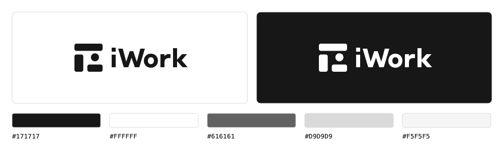

# iWork 品牌素材

- 横版标志包含图标和 iWork 字标，使用 `iwork-lockup*.svg`。
- 独立图标适合空间有限的场景，使用 `iwork-icon*.svg`。
- 浅底用炭黑版（`-black.svg`），深底用白色版（`-white.svg`）。无颜色后缀的版本使用 `currentColor`，内联时随文字颜色变化。
- 界面配色遵循 [DESIGN.md](../../DESIGN.md)。
