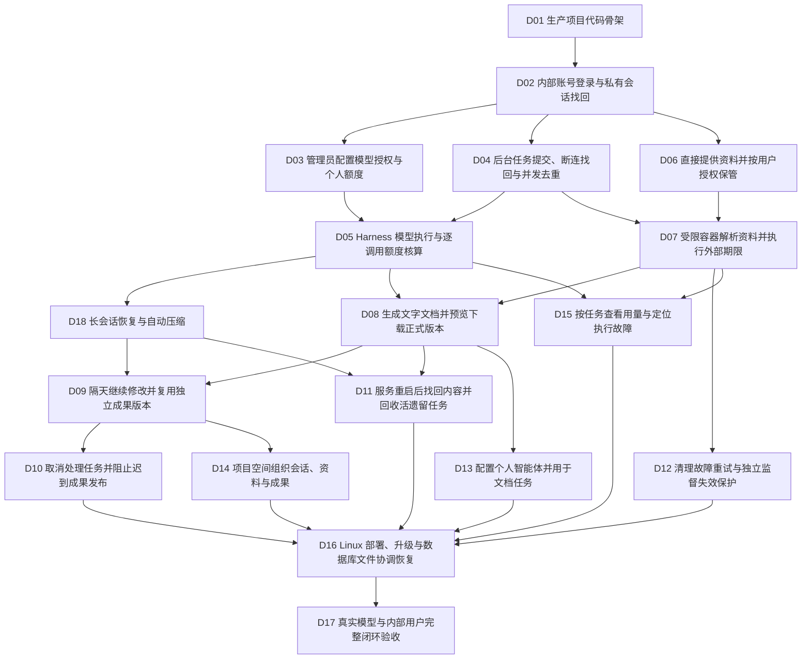

# Web 首版开发任务清单

来源：[Web 首版实施规格 #9](https://github.com/BurnerK/iWork/issues/9)。状态：2026-11-16 用户已确认 Harness 修订：保留原 17 项，新增 D18 长会话恢复与自动压缩（规划时临时编号 H01）。D01 已完成，D02–D17 保留原 GitHub 编号；D18 已发布并核对原生关系。D01–D18 是清单编号，对应下表中的实际工单；验收条件和阻塞关系以各工单及 GitHub 原生关系为准。

按用户要求，首项为生产项目代码骨架，作为业务开发前置；其余任务按完整行为拆分，数据、API、页面和测试随行为一起实现。骨架只建立已确认架构所需的可运行工程，不预先编写未来业务实现。

## 已发布工单

| 清单编号 | 工单 | 直接阻塞 |
| --- | --- | --- |
| D01 | [#10 生产项目代码骨架](https://github.com/BurnerK/iWork/issues/10) | 已关闭，保留历史验收 |
| D02 | [#11 内部账号登录与私有会话找回](https://github.com/BurnerK/iWork/issues/11) | [10](https://github.com/BurnerK/iWork/issues/10) |
| D03 | [#12 管理员配置模型授权与个人额度](https://github.com/BurnerK/iWork/issues/12) | [11](https://github.com/BurnerK/iWork/issues/11) |
| D04 | [#13 后台任务提交、断连找回与并发去重](https://github.com/BurnerK/iWork/issues/13) | [11](https://github.com/BurnerK/iWork/issues/11) |
| D05 | [#14 Harness 模型执行与逐调用额度核算](https://github.com/BurnerK/iWork/issues/14) | [12](https://github.com/BurnerK/iWork/issues/12)、[13](https://github.com/BurnerK/iWork/issues/13) |
| D06 | [#15 直接提供资料并按用户授权保管](https://github.com/BurnerK/iWork/issues/15) | [11](https://github.com/BurnerK/iWork/issues/11) |
| D07 | [#16 受限容器解析资料并执行外部期限](https://github.com/BurnerK/iWork/issues/16) | [13](https://github.com/BurnerK/iWork/issues/13)、[15](https://github.com/BurnerK/iWork/issues/15) |
| D08 | [#17 生成文字文档并预览下载正式版本](https://github.com/BurnerK/iWork/issues/17) | [14](https://github.com/BurnerK/iWork/issues/14)、[16](https://github.com/BurnerK/iWork/issues/16) |
| D09 | [#18 隔天继续修改并复用独立成果版本](https://github.com/BurnerK/iWork/issues/18) | [17](https://github.com/BurnerK/iWork/issues/17)、[27](https://github.com/BurnerK/iWork/issues/27) |
| D10 | [#19 取消处理任务并阻止迟到成果发布](https://github.com/BurnerK/iWork/issues/19) | [18](https://github.com/BurnerK/iWork/issues/18) |
| D11 | [#20 服务重启后找回内容并回收活遗留任务](https://github.com/BurnerK/iWork/issues/20) | [17](https://github.com/BurnerK/iWork/issues/17)、[27](https://github.com/BurnerK/iWork/issues/27) |
| D12 | [#21 清理故障重试与独立监督失效保护](https://github.com/BurnerK/iWork/issues/21) | [16](https://github.com/BurnerK/iWork/issues/16) |
| D13 | [#22 配置个人智能体并用于文档任务](https://github.com/BurnerK/iWork/issues/22) | [17](https://github.com/BurnerK/iWork/issues/17) |
| D14 | [#23 项目空间组织会话、资料与成果](https://github.com/BurnerK/iWork/issues/23) | [18](https://github.com/BurnerK/iWork/issues/18) |
| D15 | [#24 按任务查看用量与定位执行故障](https://github.com/BurnerK/iWork/issues/24) | [14](https://github.com/BurnerK/iWork/issues/14)、[16](https://github.com/BurnerK/iWork/issues/16) |
| D16 | [#25 Linux 部署、升级与数据库文件协调恢复](https://github.com/BurnerK/iWork/issues/25) | [19](https://github.com/BurnerK/iWork/issues/19)、[20](https://github.com/BurnerK/iWork/issues/20)、[21](https://github.com/BurnerK/iWork/issues/21)、[22](https://github.com/BurnerK/iWork/issues/22)、[23](https://github.com/BurnerK/iWork/issues/23)、[24](https://github.com/BurnerK/iWork/issues/24) |
| D17 | [#26 真实模型与内部用户完整闭环验收](https://github.com/BurnerK/iWork/issues/26) | [25](https://github.com/BurnerK/iWork/issues/25) |
| D18 | [#27 长会话恢复与自动压缩](https://github.com/BurnerK/iWork/issues/27) | [14](https://github.com/BurnerK/iWork/issues/14) |

## 拆分与直接阻塞

1. **D01 生产项目代码骨架** — 阻塞：无，已完成。建立后续正式业务开发使用的 Java 后端、Vue 前端、数据库迁移与运行配置，能够从干净检出完成构建、启动和健康检查。

2. **D02 内部账号登录与私有会话找回** — 阻塞：D01。管理员开通试用账号，用户登录后创建和找回自己的个人会话，在生产工程骨架上完成首条真实业务链路。

3. **D03 管理员配置模型授权与个人额度** — 阻塞：D02。管理员保存模型、凭据、计价与个人预算；用户在页面看到自己的可用模型和额度，配置重启后保留。

4. **D04 后台任务提交、断连找回与并发去重** — 阻塞：D02。用户在个人会话提交任务并观察状态；断开页面后仍可查回同一任务，重复提交和同会话冲突得到确定结果。

5. **D05 Harness 模型执行与逐调用额度核算** — 阻塞：D03、D04。用户通过 Harness 提交后台文字任务，得到回复及对应消耗；主推理和辅助调用统一授权、计量和取消。

6. **D06 直接提供资料并按用户授权保管** — 阻塞：D02。用户在会话提供本次资料，能够找回并选择自己的资料用于后续任务，原始文件与会话及工作区保持独立。

7. **D07 受限容器解析资料并执行外部期限** — 阻塞：D04、D06。用户提交已获准资料的处理任务并看到解析结果或失败；处理实际在隔离容器中完成，管理接口与期限监督完整接入。

8. **D08 生成文字文档并预览下载正式版本** — 阻塞：D05、D07。用户选择资料和模型，完成内容理解、工具生成、正式保存以及页面预览下载，首次打通资料到成果的端到端链路。

9. **D09 隔天继续修改并复用独立成果版本** — 阻塞：D08、D18。用户基于已保存成果在会话中提出修改，得到新版本，旧版仍可预览下载；同一成果可以被其他个人会话引用。

10. **D10 取消处理任务并阻止迟到成果发布** — 阻塞：D09。用户取消正在生成或修改的任务后保留旧成果，实际执行停止请求得到传播，处理尚未停止时页面如实说明。

11. **D11 服务重启后找回内容并回收活遗留任务** — 阻塞：D08、D18。主应用或管理服务故障重启后，用户能找回已保存内容并看见中断状态，仍活着的遗留处理容器被定向回收。

12. **D12 清理故障重试与独立监督失效保护** — 阻塞：D07。处理资源无法删除时留下可靠的待重试状态并停止接纳新处理；管理服务失效后仍由外部监督终止逾期容器。

13. **D13 配置个人智能体并用于文档任务** — 阻塞：D08。用户保存指令和模型配置，选择该智能体处理资料并生成成果，后续任务可复用配置。

14. **D14 项目空间组织会话、资料与成果** — 阻塞：D09。用户在个人项目空间组织持续工作，项目指令和选定资料能用于任务，会话与成果引用保持独立生命周期。

15. **D15 按任务查看用量与定位执行故障** — 阻塞：D05、D07。用户看到自己的任务消耗与失败信息，管理员能够通过受限的追踪入口定位调用、工具和清理问题。

16. **D16 Linux 部署、升级与数据库文件协调恢复** — 阻塞：D10、D11、D12、D13、D14、D15。部署者在目标 Linux 上运行完整首版，能够升级并通过备份恢复找回一致的业务记录和文件，获得有条件的执行期限验收结果。

17. **D17 真实模型与内部用户完整闭环验收** — 阻塞：D16。产品发起者和试用同事在实际部署上使用获准真实资料，生成方案、隔天找回并继续修改，以记录决定是否达到试用条件。

18. **D18 长会话恢复与自动压缩** — 阻塞：D05。通过已有会话页面跨请求、跨重启继续交流，触发压缩后完整业务历史保留，摘要调用归属当前用户与任务。

## 依赖图

仅列直接依赖，已传递的依赖不重复。D01 骨架完成后开始 D02 账号与会话；D02 完成后 D03/D04/D06 可分别推进；D05 与 D07 分别汇合模型/任务和任务/资料。D08 打通资料到成果；D18 在 D05 后交付上下文恢复与压缩，D09、D11 等待 D18，其余任务按原依赖推进。D16 是整版部署恢复验收，D17 是真实人员与真实模型试用门槛。

D04 以开发/测试执行替身验证后台协议，不新增面向用户的虚假处理功能；D05 接入实际模型路径。D07 首次运行容器即带外部期限与失败拒绝准入，D12 补齐故障注入和恢复。D08 首次发布成果即有终态检查，D10 扩展完整取消竞争。

## 通用完成要求

以父规格的正式测试边界为准：业务 API 为主，真实身份、MySQL 与文件存储；模型可用可控替身。涉及页面的票提供最少的可操作验收；涉及隔离/进程的票必须使用真实 Compose/Docker。测试行为和成果，不以内部调用次数或模拟删除成功替代证据。

每票随功能交付必要的授权、失败处理、数据保护与测试。重试、取消、恢复等后续票扩展组合场景，不允许前面的正式入口先缺少基本保护。已确认的高权限管理组件、条件性停止上限和供应商用量待核实限制始终保留。

规格留白分别归属 D01（工程结构、构建与基础配置）、D02（登录）、D03/D05（模型与计量）、D06/D07/D08（资料格式、解析器及文档输出）、D04/D08/D09（任务/事务/版本契约）、D07/D12/D16（监督、密钥和容量）、D16/D17（部署资源、恢复与真实试用）。这些是实施票内必须落实的选择，不表示本次已经替用户决定。

Harness 首版要求按修订规格执行；D05 接入运行入口并先关闭未验收压缩，D18 交付并启用恢复与自动压缩。D09、D11 等待 D18，正式试用不得跳过自动压缩。D01 已完成，其历史验收不覆盖新增 Harness 依赖和行为。

## 逐票验收条件

### D01 生产项目代码骨架

## Parent

[Web 首版实施规格：资料处理、后台任务与文字文档成果闭环](https://github.com/BurnerK/iWork/issues/9)

## What to build

建立后续正式业务开发使用的 Java 后端、Vue 前端、数据库迁移与运行配置，能够从干净检出完成构建、启动和健康检查。

对应父规格用户故事：1；测试场景：T16。

实施前需落实：落实正式工程目录和构建组织、基础版本兼容、配置和迁移工具。遵循已确认模块化单体与单机 Compose 边界；T16 这里只承接可运行工程的前置检查，完整 Linux 部署、升级和恢复由 D16 验收。

## Acceptance criteria

- [ ] 基于已确认的 Java 21、Spring Boot、AgentScope Java、Vue 3/TypeScript 建立正式项目入口，固定基础依赖和工具版本，前后端均可独立检查并组成可交付构建；不以探针目录作为生产入口。
- [ ] 建立模块化单体的最小代码组织和职责说明，对应身份与资源、会话与任务、智能体运行、成果与文件、模型与用量；不预写空业务 CRUD、通用接口层或无调用者的抽象。
- [ ] 提供主应用与 MySQL 的本地 Compose 启动配置及持久目录，数据库和文件不依赖容器可写层；前端构建后随主应用交付，并能从浏览器访问最小应用入口。
- [ ] 建立数据库版本迁移入口，能在干净 MySQL 初始化必要基线并在再次启动时安全重复执行；业务表随后续任务新增，不预建完整业务模型。
- [ ] 提供应用存活与就绪检查，数据库未就绪时不能伪报可服务；提供最小前后端连通验证，不向未认证页面暴露配置、凭据或内部诊断详情。
- [ ] 配置区分示例与实际凭据，提供环境变量或等效外部配置入口、必要校验和日志基线；源码、构建产物和普通日志不包含真实密钥。
- [ ] 干净检出按文档命令即可完成后端编译/测试、前端类型检查/构建和 Compose 启动验证，自动化构建检查运行相同基础命令；连接真实 MySQL 验证启动、迁移及停止数据库后的就绪反馈。
- [ ] 记录生产工程的本地运行和基础排错方式；本票不接入真实模型、不实现账号/会话业务、不部署生产环境。沙箱管理服务与看门狗在 D07 的实际处理链路中接入，主应用不挂载 Docker socket。

测试边界：以父规格的正式测试边界为准：业务 API 为主，真实身份、MySQL 与文件存储；模型可用可控替身。涉及页面的票提供最少的可操作验收；涉及隔离/进程的票必须使用真实 Compose/Docker。测试行为和成果，不以内部调用次数或模拟删除成功替代证据。

每票随功能交付必要的授权、失败处理、数据保护与测试。重试、取消、恢复等后续票扩展组合场景，不允许前面的正式入口先缺少基本保护。已确认的高权限管理组件、条件性停止上限和供应商用量待核实限制始终保留。

## Blocked by

无，可开始。

### D02 内部账号登录与私有会话找回

## Parent

[Web 首版实施规格：资料处理、后台任务与文字文档成果闭环](https://github.com/BurnerK/iWork/issues/9)

## What to build

管理员开通试用账号，用户登录后创建和找回自己的个人会话，在生产工程骨架上完成首条真实业务链路。

对应父规格用户故事：1, 2, 7, 8, 34；测试场景：T01, T02, T05。

实施前需落实：落实首版登录方式、初始管理员、账号停用与会话安全；只服务内部试用，不能把完整企业登录集成默认带入。复用 D01 已固定的基础依赖和配置约定。

## Acceptance criteria

- [ ] 管理员能完成初始化及首批账号开通/停用；用户能登录、退出，非法或失效身份不能访问受保护入口，不开放公开注册。
- [ ] 用户能创建、列出、打开自己的独立会话；身份和会话存入真实 MySQL，服务重启后仍能找回。
- [ ] 两个独立用户的会话互不可见；猜测标识和普通用户调用管理接口被拒；管理员不因角色而自动读取他人会话内容。
- [ ] API 集成测试覆盖登录、停用、退出失效、角色和归属反向用例；浏览器能完成管理员开通账号及用户登录/创建/重开会话。
- [ ] 账号、会话表及必要迁移沿用 D01 的正式工程和迁移入口；从 API 到页面验证业务，不重复建立另一套构建或临时演示工程。

测试边界：以父规格的正式测试边界为准：业务 API 为主，真实身份、MySQL 与文件存储；模型可用可控替身。涉及页面的票提供最少的可操作验收；涉及隔离/进程的票必须使用真实 Compose/Docker。测试行为和成果，不以内部调用次数或模拟删除成功替代证据。

每票随功能交付必要的授权、失败处理、数据保护与测试。重试、取消、恢复等后续票扩展组合场景，不允许前面的正式入口先缺少基本保护。已确认的高权限管理组件、条件性停止上限和供应商用量待核实限制始终保留。

## Blocked by

- D01 生产项目代码骨架

### D03 管理员配置模型授权与个人额度

## Parent

[Web 首版实施规格：资料处理、后台任务与文字文档成果闭环](https://github.com/BurnerK/iWork/issues/9)

## What to build

管理员保存模型、凭据、计价与个人预算；用户在页面看到自己的可用模型和额度，配置重启后保留。

对应父规格用户故事：3, 4, 5, 14, 35；测试场景：T01。

实施前需落实：明确模型连接配置、计价和金额精度等最小契约；本票不新增对外模型 API Key、应用预算或供应商对账。

## Acceptance criteria

- [ ] 管理员能配置上游模型及凭据、模型使用授权、实例币种/计价与个人额度，保存后真实持久化，重启后保持。
- [ ] 用户仅能看到获授权模型和自己的额度；普通用户不能修改管理员配置，也不能获取上游明文凭据或他人额度。
- [ ] 无效配置有明确校验反馈；模型/用户关联及金额校验在后端执行，不仅依靠页面限制。
- [ ] 模型凭据不写入源码、响应、浏览器或普通日志；配置变更不改变既有用量事实或通过重新配置隐式清零消耗。
- [ ] API 和关键管理页面覆盖保存、读取、权限撤销及越权；本票只验配置闭环，真实模型调用和额度扣减由 D05 接入。

测试边界：以父规格的正式测试边界为准：业务 API 为主，真实身份、MySQL 与文件存储；模型可用可控替身。涉及页面的票提供最少的可操作验收；涉及隔离/进程的票必须使用真实 Compose/Docker。测试行为和成果，不以内部调用次数或模拟删除成功替代证据。

每票随功能交付必要的授权、失败处理、数据保护与测试。重试、取消、恢复等后续票扩展组合场景，不允许前面的正式入口先缺少基本保护。已确认的高权限管理组件、条件性停止上限和供应商用量待核实限制始终保留。

## Blocked by

- D02 内部账号登录与私有会话找回

### D04 后台任务提交、断连找回与并发去重

## Parent

[Web 首版实施规格：资料处理、后台任务与文字文档成果闭环](https://github.com/BurnerK/iWork/issues/9)

## What to build

用户在个人会话提交任务并观察状态；断开页面后仍可查回同一任务，重复提交和同会话冲突得到确定结果。

对应父规格用户故事：16, 17, 18, 19, 20, 21, 22, 23, 25, 26；测试场景：T06, T07, T09。

实施前需落实：确定最小任务/幂等/会话互斥持久化契约与页面观察协议。基本取消和重启归档在此成立；D10/D11 后续覆盖模型、成果和容器的组合行为。

## Acceptance criteria

- [ ] 任务、消息与请求身份持久化；页面可提交、查看运行/完成/失败/取消/中断状态，执行由服务端托管，不绑定观察连接。
- [ ] 并发同键同参数只产生一个任务；同键改变参数被拒；调用者之间的幂等键隔离，同会话同时只执行一个任务，后续请求在限额内排队。
- [ ] 不同会话在已配置的小范围容量内可分别运行；断开提交或观察连接、重开页面均不再次执行同一请求。
- [ ] 基本取消能成为持久业务终态，终态不能被迟到完成回写覆盖；查询和取消均校验资源归属。
- [ ] 主进程启动时把遗留未完成任务标记中断且不自动重跑；重提旧请求返回原任务，不恢复为运行。
- [ ] 以开发/测试专用的可控执行替身验证真实业务入口、数据库并发及页面；替身不作为正式业务处理功能向试用用户开放。
- [ ] API 与浏览器断连测试证明任务身份及状态稳定，后台执行不持有覆盖整段处理的数据库事务。

- [ ] iWork 后台任务持有 Harness 执行与取消句柄，页面观察不控制 SDK 订阅生命周期；SDK 完成信号不能绕过业务终态。重试同一请求或恢复 SDK 上下文时不得自动重启任务。

测试边界：以父规格的正式测试边界为准：业务 API 为主，真实身份、MySQL 与文件存储；模型可用可控替身。涉及页面的票提供最少的可操作验收；涉及隔离/进程的票必须使用真实 Compose/Docker。测试行为和成果，不以内部调用次数或模拟删除成功替代证据。

每票随功能交付必要的授权、失败处理、数据保护与测试。重试、取消、恢复等后续票扩展组合场景，不允许前面的正式入口先缺少基本保护。已确认的高权限管理组件、条件性停止上限和供应商用量待核实限制始终保留。

## Blocked by

- D02 内部账号登录与私有会话找回

### D05 Harness 模型执行与逐调用额度核算

## Parent

[Web 首版实施规格：资料处理、后台任务与文字文档成果闭环](https://github.com/BurnerK/iWork/issues/9)

## What to build

用户选择获授权模型，通过 Harness 提交后台文字任务，得到模型回复及对应消耗；主推理和辅助调用均受统一权限、额度与取消约束。

对应父规格用户故事：14, 35, 36, 37, 38, 46；测试场景：T01, T10, T15, T18, T19。

实施前需落实：落实 #9 留白中的预占与估算算法、可靠性不足时处理、差额调整和重试/输出限额。若改变已确认的估算后释放原则，返回决策；不扩展完整账单对账。

## Acceptance criteria

- [ ] 使用 HarnessAgent 执行获授权模型调用并将回复及调用记录关联到当前用户、会话和任务；不能用智能体创建者身份或预算代替调用者。
- [ ] 每次实际调用/重试在执行前通过模型权限与个人额度检查，预占和核算持久化；并发会话不能重复使用同一笔可用内部额度。
- [ ] 逐调用保留已有用量、来源、时间和可获得的供应商标识；缺少完整回报时按明确规则估算并标注用量待核实，不能因任务中其他调用有回报而漏记。
- [ ] 成功、失败、取消和重启收尾释放预占，已知用量不丢失；重复累计回报不会重复扣减；估算与供应商实际用量分开。
- [ ] 取消传到实际执行订阅，不为取得用量默认继续生成；本地终止不等于供应商停止或结清，页面如实呈现。
- [ ] 明确并实现预占、估算、无法可靠估算以及迟到可靠回报的处理规则，记录来源与调整依据；不得以永久冻结或未知置零替代设计。
- [ ] 可控模型边界下验证正常、多次调用、错误、缺失/重复回报、取消、并发额度和重启收尾；正式供应商兼容与实际资源验收由 D17 完成，生产路径不能依赖替身。

- [ ] 正式运行入口使用 HarnessAgent 2.0.4，相关 SDK 模块同版本；完成新增依赖组合、序列化/MCP 兼容及安全检查。沿用正式工程约束，不照搬历史原型依赖。
- [ ] 从首次正式接入起显式限制工具与能力：仅开放本票所需获准业务工具，关闭通用文件/shell/Web、动态 Skill/MCP、子智能体、Plan Mode、长期记忆及独立会话日志；不使用 SDK 默认用户目录持久化。初次接入显式关闭压缩及大结果卸载，由上下文任务实现并开启首版必需的自动压缩。
- [ ] 统一模型调用入口覆盖主推理、摘要及溢出恢复的每次实际尝试，记录调用用途并关联当前用户、会话和任务；辅助调用同样执行授权、预占、估算、取消、超时和总尝试限制，不仅依赖主循环事件。
- [ ] 供应商边界观察实际工具 schema 和请求，证明模型不能调用未授权能力；可控主调用及辅助调用均可通过业务用量查询核对，权限撤销、取消后新调用拒绝及重复回报处理有效。

测试边界：以父规格的正式测试边界为准：业务 API 为主，真实身份、MySQL 与文件存储；模型可用可控替身。涉及页面的票提供最少的可操作验收；涉及隔离/进程的票必须使用真实 Compose/Docker。测试行为和成果，不以内部调用次数或模拟删除成功替代证据。

每票随功能交付必要的授权、失败处理、数据保护与测试。重试、取消、恢复等后续票扩展组合场景，不允许前面的正式入口先缺少基本保护。已确认的高权限管理组件、条件性停止上限和供应商用量待核实限制始终保留。

## Blocked by

- D03 管理员配置模型授权与个人额度
- D04 后台任务提交、断连找回与并发去重

### D06 直接提供资料并按用户授权保管

## Parent

[Web 首版实施规格：资料处理、后台任务与文字文档成果闭环](https://github.com/BurnerK/iWork/issues/9)

## What to build

用户在会话提供本次资料，能够找回并选择自己的资料用于后续任务，原始文件与会话及工作区保持独立。

对应父规格用户故事：12, 13, 33, 34；测试场景：T03, T05。

实施前需落实：在本票明确首版输入格式和大小清单、输入契约及失败反馈，供 D07/D08 沿用；不借机增加平台知识库或外部链接抓取。

## Acceptance criteria

- [ ] 页面和 API 支持已选定的首版资料输入方式，原始内容及所有权、索引持久保存；再次进入可找回。
- [ ] 明确列出支持格式和大小限制，超限、不支持或不完整输入有明确错误；不默认支持所有 Office/PDF 格式。
- [ ] 不同用户不能读、引用或覆盖彼此资料；客户端文件名、路径和资源标识不能越出授权范围。
- [ ] 原始资料作为正式资源保存，不直接充当任务临时目录；本票只安全接收和保管，不在主应用内解析不可信文档。
- [ ] 真实存储的 API 测试与页面上传/重新进入验证通过，失败上传不留下可引用的不完整资源。
- [ ] 为 D07 提供按调用者取得获准输入的业务能力，未来项目引用不改变资料所有权。

测试边界：以父规格的正式测试边界为准：业务 API 为主，真实身份、MySQL 与文件存储；模型可用可控替身。涉及页面的票提供最少的可操作验收；涉及隔离/进程的票必须使用真实 Compose/Docker。测试行为和成果，不以内部调用次数或模拟删除成功替代证据。

每票随功能交付必要的授权、失败处理、数据保护与测试。重试、取消、恢复等后续票扩展组合场景，不允许前面的正式入口先缺少基本保护。已确认的高权限管理组件、条件性停止上限和供应商用量待核实限制始终保留。

## Blocked by

- D02 内部账号登录与私有会话找回

### D07 受限容器解析资料并执行外部期限

## Parent

[Web 首版实施规格：资料处理、后台任务与文字文档成果闭环](https://github.com/BurnerK/iWork/issues/9)

## What to build

用户提交已获准资料的处理任务并看到解析结果或失败；处理实际在隔离容器中完成，管理接口与期限监督完整接入。

对应父规格用户故事：12, 13, 24, 33, 39, 41；测试场景：T05, T11, T14。

实施前需落实：落实实际解析器与镜像版本、管理接口与密钥分发、初始资源/期限参数。优先复用已验证 SDK 能力和探针经验，不原样复制测试凭据/故障开关。

## Acceptance criteria

- [ ] 主应用通过内部接口提交固定处理操作，使用正式服务身份与逐任务授权；用户可从已有任务页面看到结果或失败，处理结果是任务材料而非冒充正式成果。
- [ ] 对 D06 的支持格式使用真实解析程序，在受限任务容器实际执行；每任务只接收获准资料，原始资料和其他任务文件不可被覆盖或越界读取。
- [ ] 管理服务固定镜像、命令、挂载、网络与资源限制，拒绝任意参数和 Docker API 转发；错误服务身份、跨任务访问和路径攻击被拒。
- [ ] 主应用与处理容器没有 Docker socket；管理服务和独立看门狗持有 Docker 权限，但不持有主数据库或模型凭据；管理接口不公开宿主端口。
- [ ] 从首次实际运行起启用容器外看门狗，按 Docker 创建时间与实例标签回收到期任务；处理容器不能改写期限，监督过期拒绝新增处理任务。
- [ ] 正常完成、取消和超时均执行终止/清理核验；持久记录容器关联，只有独立确认删除才报告清理完成，失败保留未知并阻止新增，不能等待后续票才具备此保护。
- [ ] 真实 Compose/Docker 测试验证真实解析、授权、网络/挂载/资源限制、凭据不可见和正常超时回收；D12 扩展系统性故障注入与恢复，生产期限在 D16 标定。

- [ ] Harness 仅通过固定业务工具请求管理服务；不通过默认 DockerFilesystemSpec、通用命令或主应用 Docker socket 绕过管理服务与看门狗。

测试边界：以父规格的正式测试边界为准：业务 API 为主，真实身份、MySQL 与文件存储；模型可用可控替身。涉及页面的票提供最少的可操作验收；涉及隔离/进程的票必须使用真实 Compose/Docker。测试行为和成果，不以内部调用次数或模拟删除成功替代证据。

每票随功能交付必要的授权、失败处理、数据保护与测试。重试、取消、恢复等后续票扩展组合场景，不允许前面的正式入口先缺少基本保护。已确认的高权限管理组件、条件性停止上限和供应商用量待核实限制始终保留。

## Blocked by

- D04 后台任务提交、断连找回与并发去重
- D06 直接提供资料并按用户授权保管

### D08 生成文字文档并预览下载正式版本

## Parent

[Web 首版实施规格：资料处理、后台任务与文字文档成果闭环](https://github.com/BurnerK/iWork/issues/9)

## What to build

用户选择资料和模型，完成内容理解、工具生成、正式保存以及页面预览下载，首次打通资料到成果的端到端链路。

对应父规格用户故事：16, 22, 25, 27, 28, 29, 32, 33；测试场景：T03, T04, T08, T18。

实施前需落实：明确输出格式、最小预览交互及数据库/文件一致性方案；不默认引入富文本协作编辑器、表格或演示文稿。

## Acceptance criteria

- [ ] 任务真实调用模型理解资料并使用固定业务工具生成文字文档，模型不能要求执行任意 shell 或代码；SDK 完成不直接等同于成果完成。
- [ ] 在实现前确定首版输出格式和预览/下载行为；页面能打开并下载内容完整、可读且符合约定格式的正式文档。
- [ ] 成果、版本与任务具有独立身份，数据库保存版本和文件索引，文件内容存入持久目录；重开页面和服务后可找回。
- [ ] 提交事务校验任务终态，取消已生效或结果重复时不得新增正式版本；数据库和文件提交顺序、失败清理规则有明确实现。
- [ ] 保存失败不能登记假成功或发布不完整文件；工作区清理保留原始资料及成果，下载/预览继续实施所有权校验。
- [ ] 使用真实数据库、文件、受限处理路径与可控模型完成 API/浏览器全链路；检查实际工具执行和正文，不以页面完成提示替代文件验收。
- [ ] 基本的取消拦截、幂等版本发布及错误反馈随本票交付，D10 再覆盖修改中途与多服务迟到响应的完整竞争矩阵。

- [ ] 文档任务使用 HarnessAgent 和显式获准业务工具；资料与工具结果按业务契约有界读取，不开放通用文件工具以绕过授权。执行工作区、运行上下文快照与正式成果生命周期独立，SDK 写入或返回成功不能直接发布成果。

测试边界：以父规格的正式测试边界为准：业务 API 为主，真实身份、MySQL 与文件存储；模型可用可控替身。涉及页面的票提供最少的可操作验收；涉及隔离/进程的票必须使用真实 Compose/Docker。测试行为和成果，不以内部调用次数或模拟删除成功替代证据。

每票随功能交付必要的授权、失败处理、数据保护与测试。重试、取消、恢复等后续票扩展组合场景，不允许前面的正式入口先缺少基本保护。已确认的高权限管理组件、条件性停止上限和供应商用量待核实限制始终保留。

## Blocked by

- D05 Harness 模型执行与逐调用额度核算
- D07 受限容器解析资料并执行外部期限

### D09 隔天继续修改并复用独立成果版本

## Parent

[Web 首版实施规格：资料处理、后台任务与文字文档成果闭环](https://github.com/BurnerK/iWork/issues/9)

## What to build

用户基于已保存成果在会话中提出修改，得到新版本，旧版仍可预览下载；同一成果可以被其他个人会话引用。

对应父规格用户故事：7, 29, 30, 31, 32, 44, 45；测试场景：T04, T05, T08, T17, T18。

实施前需落实：确定选定版本继续修改的最小交互与并发版本处理，不引入同会话分支对比、分享或协同编辑。

## Acceptance criteria

- [ ] 用户能在当前或另一个自己的会话选择获准的成果版本，提出修改要求并生成同一成果的新独立版本。
- [ ] 页面可区分成果身份和版本，找回并预览/下载旧版及新版；原始版本字节保持不变，不以任务 ID 代替正式成果身份。
- [ ] 多个个人会话引用同一成果不会复制或转移所有权，猜测他人成果或版本标识不能用于修改与引用。
- [ ] 并发版本提交、重复结果和保存失败不得丢失已保存版本或留下不完整的正式版本；相关约束在业务持久化边界生效。
- [ ] 真实持久化与浏览器用例验证生成、找回、基于旧版修改及跨会话引用，清理原任务工作区后仍能修改。
- [ ] 服务重启后历史版本仍可使用；真实隔天试用记录在 D17 完成，本票不能仅以模拟时钟声称真实试用已通过。

- [ ] 等待长会话恢复与自动压缩任务完成；通过已有会话页面恢复上下文并在压缩后继续修改成果，完整业务消息、来源版本和旧版本字节均保留。切换会话引用成果不会复制另一会话的 SDK 快照或授权。

测试边界：以父规格的正式测试边界为准：业务 API 为主，真实身份、MySQL 与文件存储；模型可用可控替身。涉及页面的票提供最少的可操作验收；涉及隔离/进程的票必须使用真实 Compose/Docker。测试行为和成果，不以内部调用次数或模拟删除成功替代证据。

每票随功能交付必要的授权、失败处理、数据保护与测试。重试、取消、恢复等后续票扩展组合场景，不允许前面的正式入口先缺少基本保护。已确认的高权限管理组件、条件性停止上限和供应商用量待核实限制始终保留。

## Blocked by

- D08 生成文字文档并预览下载正式版本
- D18 长会话恢复与自动压缩

### D10 取消处理任务并阻止迟到成果发布

## Parent

[Web 首版实施规格：资料处理、后台任务与文字文档成果闭环](https://github.com/BurnerK/iWork/issues/9)

## What to build

用户取消正在生成或修改的任务后保留旧成果，实际执行停止请求得到传播，处理尚未停止时页面如实说明。

对应父规格用户故事：22, 23, 24, 25, 32, 36, 46；测试场景：T08, T10, T11, T19。

实施前需落实：沿用已确定任务终态及版本边界，细化取消结果和进程/清理状态的用户表达，不重新定义可回滚的取消。

## Acceptance criteria

- [ ] 取消通过真实业务入口传播至模型订阅及沙箱管理服务；业务取消、处理进程状态和清理状态分别记录及展示。
- [ ] 覆盖模型响应前、输出中、草稿完成待提交、提交并发以及修改已有成果时的取消；取消先成立拒绝发布，提交先成功保留完成事实。
- [ ] 远端成功在取消后经新查询到达，并经过与正常任务相同的正式提交入口被拒；重复到达仍拒绝，旧版本及正式版本数量不变。
- [ ] 实际保存失败或处理失败保留旧版本；无法确认进程停止时不可显示已清理，不以 SDK 返回或 docker exec 客户端退出充当停止证据。
- [ ] 取消后保留已有用量、估算缺口并释放预占，未知供应商执行与费用不变为零；同会话后续任务仍受处理服务清理准入控制。
- [ ] API 竞争测试、真实容器停止观察与关键页面状态通过；故障夹具只用于测试，不暴露为产品人工批准按钮或绕过终态的接口。

- [ ] 覆盖主推理、摘要压缩、溢出恢复及固定工具执行中的取消，均传播至实际调用；保留已知用量或估算，终态后不新开辅助调用，不复活任务、重放工具或发布迟到成果。取消前可用的历史与快照不能被不完整摘要覆盖。

测试边界：以父规格的正式测试边界为准：业务 API 为主，真实身份、MySQL 与文件存储；模型可用可控替身。涉及页面的票提供最少的可操作验收；涉及隔离/进程的票必须使用真实 Compose/Docker。测试行为和成果，不以内部调用次数或模拟删除成功替代证据。

每票随功能交付必要的授权、失败处理、数据保护与测试。重试、取消、恢复等后续票扩展组合场景，不允许前面的正式入口先缺少基本保护。已确认的高权限管理组件、条件性停止上限和供应商用量待核实限制始终保留。

## Blocked by

- D09 隔天继续修改并复用独立成果版本

### D11 服务重启后找回内容并回收活遗留任务

## Parent

[Web 首版实施规格：资料处理、后台任务与文字文档成果闭环](https://github.com/BurnerK/iWork/issues/9)

## What to build

主应用或管理服务故障重启后，用户能找回已保存内容并看见中断状态，仍活着的遗留处理容器被定向回收。

对应父规格用户故事：26, 29, 33, 36, 38, 39, 44, 45；测试场景：T09, T12, T17, T19。

实施前需落实：细化业务归档与容器回收的恢复顺序、状态核对及重复执行规则；不增加自动续跑或多实例选主。

## Acceptance criteria

- [ ] 分别在模型调用、容器处理及成果提交附近强杀主应用；恢复后已保存成果可读，未完成任务归档为中断，不自动重跑。
- [ ] 旧请求重提和页面重连仍找到原任务；同会话活动约束不会永久占用，重新发起须使用新请求并通过实际准入检查。
- [ ] 已知用量和缺口保留，预占按 D05 规则幂等收尾；重复启动恢复不重复扣减、发布或释放。
- [ ] 在管理服务重启前证明至少两个遗留容器及其子进程仍存活，再验证启动回收、实际删除及业务查询的一致状态。
- [ ] 不同实例标签的对照资源不被删除；恢复只依据本实例身份和持久关联，不清空整个 Docker 引擎。
- [ ] 数据库与文件提交中断时保留完整正式版本，不暴露半成品；真实进程/容器故障测试与页面重入证明结果，断电恢复范围留给部署验收说明。

- [ ] 等待上下文任务完成；在压缩及快照写入附近注入强杀，恢复后核对业务任务与 MySQL 快照/摘要。旧任务仍为中断，快照不启动调用或待执行工具；显式新任务依据有效业务记录恢复或重建上下文，无法确认时明确失败。

测试边界：以父规格的正式测试边界为准：业务 API 为主，真实身份、MySQL 与文件存储；模型可用可控替身。涉及页面的票提供最少的可操作验收；涉及隔离/进程的票必须使用真实 Compose/Docker。测试行为和成果，不以内部调用次数或模拟删除成功替代证据。

每票随功能交付必要的授权、失败处理、数据保护与测试。重试、取消、恢复等后续票扩展组合场景，不允许前面的正式入口先缺少基本保护。已确认的高权限管理组件、条件性停止上限和供应商用量待核实限制始终保留。

## Blocked by

- D08 生成文字文档并预览下载正式版本
- D18 长会话恢复与自动压缩

### D12 清理故障重试与独立监督失效保护

## Parent

[Web 首版实施规格：资料处理、后台任务与文字文档成果闭环](https://github.com/BurnerK/iWork/issues/9)

## What to build

处理资源无法删除时留下可靠的待重试状态并停止接纳新处理；管理服务失效后仍由外部监督终止逾期容器。

对应父规格用户故事：24, 39, 40, 41；测试场景：T13, T14。

实施前需落实：落实清理重试、健康记录有效期与监督恢复策略；仅围绕固定处理任务，不增加通用调度平台。

## Acceptance criteria

- [ ] 分别注入真实删除拒绝和管理服务到 Docker 通信失败，取消后持久保留业务终态、清理待重试及进程未知；证明容器仍在运行，不能虚报删除。
- [ ] 故障期间新处理任务被拒且不偷偷新建容器；恢复后自动重试并独立核验删除，业务终态不恢复成运行。
- [ ] 待重试记录在管理服务重启后保留；重复回收幂等，错误实例资源不受影响，原始资料及正式成果不被清理。
- [ ] 强杀主应用和管理服务，处理子进程仍运行时由独立看门狗按原创建时间终止，工作区伪造期限无效。
- [ ] 停用看门狗、使健康记录过期后拒绝新增；恢复时不重置存活任务期限，确认恢复后才重新接受请求。
- [ ] 记录发现到期及确认删除的时间，区分业务取消、真实停止和清理；测试只承诺监督、Docker、宿主与时钟可用条件下的结果，不套用探针秒数为生产 SLA。

测试边界：以父规格的正式测试边界为准：业务 API 为主，真实身份、MySQL 与文件存储；模型可用可控替身。涉及页面的票提供最少的可操作验收；涉及隔离/进程的票必须使用真实 Compose/Docker。测试行为和成果，不以内部调用次数或模拟删除成功替代证据。

每票随功能交付必要的授权、失败处理、数据保护与测试。重试、取消、恢复等后续票扩展组合场景，不允许前面的正式入口先缺少基本保护。已确认的高权限管理组件、条件性停止上限和供应商用量待核实限制始终保留。

## Blocked by

- D07 受限容器解析资料并执行外部期限

### D13 配置个人智能体并用于文档任务

## Parent

[Web 首版实施规格：资料处理、后台任务与文字文档成果闭环](https://github.com/BurnerK/iWork/issues/9)

## What to build

用户保存指令和模型配置，选择该智能体处理资料并生成成果，后续任务可复用配置。

对应父规格用户故事：13, 14, 15；测试场景：T03, T05, T10, T18。

实施前需落实：明确最小配置字段与选择交互，尊重初始化配置和当前授权的不同生命周期。

## Acceptance criteria

- [ ] 用户能创建、修改和找回自己的智能体指令/模型配置，并在会话发起使用该配置的文档任务。
- [ ] 实际执行使用所选初始化配置和平台固定工具，生成成果可预览下载；不能只验证配置保存页面。
- [ ] 配置不能扩展资料、模型或工具权限；运行前和实际访问时校验有效授权，旧配置不能保留已撤销的权限。
- [ ] 执行中的配置编辑不静默改变已初始化任务；后续任务使用最新有效配置，行为有确定性测试。
- [ ] 配置归属、任务归属及预算承担明确为当前使用者；跨用户配置或资料访问被拒，私人凭据不嵌入智能体配置。
- [ ] API 与浏览器覆盖保存配置、执行资料任务、重开复用、权限撤销及用量归属；不增加 Skill/MCP、分享或多智能体。

- [ ] 智能体初始化配置映射到 Harness，当前调用身份与预算由 iWork 提供；运行快照不能带回旧工具、旧模型授权或覆盖本次初始化配置。未来新任务使用有效的新配置，不依赖共享可变 Agent 上的用户配置。

测试边界：以父规格的正式测试边界为准：业务 API 为主，真实身份、MySQL 与文件存储；模型可用可控替身。涉及页面的票提供最少的可操作验收；涉及隔离/进程的票必须使用真实 Compose/Docker。测试行为和成果，不以内部调用次数或模拟删除成功替代证据。

每票随功能交付必要的授权、失败处理、数据保护与测试。重试、取消、恢复等后续票扩展组合场景，不允许前面的正式入口先缺少基本保护。已确认的高权限管理组件、条件性停止上限和供应商用量待核实限制始终保留。

## Blocked by

- D08 生成文字文档并预览下载正式版本

### D14 项目空间组织会话、资料与成果

## Parent

[Web 首版实施规格：资料处理、后台任务与文字文档成果闭环](https://github.com/BurnerK/iWork/issues/9)

## What to build

用户在个人项目空间组织持续工作，项目指令和选定资料能用于任务，会话与成果引用保持独立生命周期。

对应父规格用户故事：7, 9, 10, 11, 13, 31, 34, 44, 45；测试场景：T02, T04, T05, T17, T18。

实施前需落实：细化项目指令与本次任务配置的组合规则及引用交互；如会改变已有主要用户流程则在实施时呈现具体选择。

## Acceptance criteria

- [ ] 用户能创建、找回自己的项目空间，设置项目指令、引用获准资料/成果并把个人会话移入或移出。
- [ ] 在项目中发起任务时实际使用明确纳入本次执行的项目指令与获准资料，生成/修改成果可从项目再次找回。
- [ ] 同一成果可被多个个人项目和会话引用，不改变资源身份和所有者；资料引用不绕过实际访问授权。
- [ ] 删除项目仅解除组织与引用关系，相关会话、原始资料及成果版本仍能在独立入口找回和使用。
- [ ] 两个用户的项目与引用隔离，猜测项目/资源 ID 被拒；管理员不自动获得私人项目内容访问权。
- [ ] API 与浏览器验证项目使用任务、移动会话、复用成果、删除项目后资源保留；不引入多人共享项目或知识库。

- [ ] 项目指令和选定资料由业务层按初始化配置及当前授权提供给 Harness，不从工作区任意加载用户规则或动态工具。会话移动或项目删除不改变快照的用户/会话归属，后续新任务不继续注入已移除的项目指令。

测试边界：以父规格的正式测试边界为准：业务 API 为主，真实身份、MySQL 与文件存储；模型可用可控替身。涉及页面的票提供最少的可操作验收；涉及隔离/进程的票必须使用真实 Compose/Docker。测试行为和成果，不以内部调用次数或模拟删除成功替代证据。

每票随功能交付必要的授权、失败处理、数据保护与测试。重试、取消、恢复等后续票扩展组合场景，不允许前面的正式入口先缺少基本保护。已确认的高权限管理组件、条件性停止上限和供应商用量待核实限制始终保留。

## Blocked by

- D09 隔天继续修改并复用独立成果版本

### D15 按任务查看用量与定位执行故障

## Parent

[Web 首版实施规格：资料处理、后台任务与文字文档成果闭环](https://github.com/BurnerK/iWork/issues/9)

## What to build

用户看到自己的任务消耗与失败信息，管理员能够通过受限的追踪入口定位调用、工具和清理问题。

对应父规格用户故事：6, 22, 24, 25, 36, 37, 40, 46；测试场景：T01, T10, T13, T16, T19。

实施前需落实：确定最小追踪关联、保留和脱敏范围；不因管理便利引入默认私人内容阅读权限。

## Acceptance criteria

- [ ] 任务、模型调用、工具处理及容器管理记录具有可关联的标识和时间线，能从一次失败定位到相应阶段及原因。
- [ ] 用户可查看自己的任务状态、用量来源/待核实和可理解的错误；管理员可查看管理职责所需的额度及运行诊断，不默认读取私人正文。
- [ ] 失败信息区分业务取消、供应商执行未知、处理停止未知与清理待重试，不能汇总成误导的已全部停止。
- [ ] 管理入口与日志避免泄露模型/数据库/管理凭据及未经授权的私人内容；跨用户诊断查询执行权限检查。
- [ ] 以模型错误、处理失败和清理未知样本证明查询及页面可定位，API 测试覆盖权限和脱敏；后续票复用并扩展该追踪入口。
- [ ] 不建设独立可观测平台或新增队列；基础错误与调用记录已随前置功能产生，本票交付聚合查询和受限管理视图。

- [ ] 用量和故障视图区分主推理、上下文压缩及溢出恢复/重试，辅助调用归属当前用户和任务；可定位摘要失败、快照不一致与取消阶段，诊断不默认暴露摘要或完整私人历史。复用模型执行票的调用记录验证查询，完整压缩链路由上下文任务验收。

测试边界：以父规格的正式测试边界为准：业务 API 为主，真实身份、MySQL 与文件存储；模型可用可控替身。涉及页面的票提供最少的可操作验收；涉及隔离/进程的票必须使用真实 Compose/Docker。测试行为和成果，不以内部调用次数或模拟删除成功替代证据。

每票随功能交付必要的授权、失败处理、数据保护与测试。重试、取消、恢复等后续票扩展组合场景，不允许前面的正式入口先缺少基本保护。已确认的高权限管理组件、条件性停止上限和供应商用量待核实限制始终保留。

## Blocked by

- D05 Harness 模型执行与逐调用额度核算
- D07 受限容器解析资料并执行外部期限

### D16 Linux 部署、升级与数据库文件协调恢复

## Parent

[Web 首版实施规格：资料处理、后台任务与文字文档成果闭环](https://github.com/BurnerK/iWork/issues/9)

## What to build

部署者在目标 Linux 上运行完整首版，能够升级并通过备份恢复找回一致的业务记录和文件，获得有条件的执行期限验收结果。

对应父规格用户故事：1, 26, 29, 39, 40, 41, 42, 44, 45；测试场景：T09, T11, T12, T13, T14, T16, T17, T18, T19。

实施前需落实：落实 #9 中服务器与运维留白；缺少外部资源时明确需要的资源/授权，不擅自创建付费服务。无需依赖项目功能来写部署脚本，但完整发布/恢复验收须等待所列功能就绪。

## Acceptance criteria

- [ ] 明确获授权的目标服务器、正式依赖/镜像、容量、服务身份与密钥分发、备份位置和恢复目标，不借用其他项目资源或测试凭据。
- [ ] 单机 Compose 可部署完整主应用、MySQL、仅存登录态的 Redis、管理服务和看门狗；管理控制面不发布宿主端口，真实卷和服务权限符合已确认边界。
- [ ] 实际完成一次升级与维护窗口验证；保留已保存内容，运行中任务按已确认中断行为处理，失败有可定位记录。
- [ ] 完成一次数据库与文件协调备份并在受控恢复环境实际恢复，用户、任务、用量、成果索引与文件相互一致，页面可找回及下载。
- [ ] 在目标机器和记录的负载下验证文件限制、清理重试、故障恢复与外部期限，给出期限/扫描余量及条件，不把本机探针 15.235 秒当生产 SLA。
- [ ] 重跑相关故障及授权矩阵；区分进程强杀、存储故障、断电与全宿主故障的实际验证范围，未验证项如实记录。
- [ ] 提供可执行的部署、升级和恢复说明及脱敏证据；本票不能因缺少目标机器只完成文档就关闭，也不将部署通过等同于真实用户验收。

- [ ] 将 MySQL 中运行上下文快照、会话摘要及业务关联纳入升级和协调备份恢复；验证不依赖 SDK 默认用户目录或独立日志，恢复后显式新任务可继续已保存会话，旧任务不自动续跑。检查 Harness 实际依赖组合与启用能力符合首版规格。

测试边界：以父规格的正式测试边界为准：业务 API 为主，真实身份、MySQL 与文件存储；模型可用可控替身。涉及页面的票提供最少的可操作验收；涉及隔离/进程的票必须使用真实 Compose/Docker。测试行为和成果，不以内部调用次数或模拟删除成功替代证据。

每票随功能交付必要的授权、失败处理、数据保护与测试。重试、取消、恢复等后续票扩展组合场景，不允许前面的正式入口先缺少基本保护。已确认的高权限管理组件、条件性停止上限和供应商用量待核实限制始终保留。

## Blocked by

- D10 取消处理任务并阻止迟到成果发布
- D11 服务重启后找回内容并回收活遗留任务
- D12 清理故障重试与独立监督失效保护
- D13 配置个人智能体并用于文档任务
- D14 项目空间组织会话、资料与成果
- D15 按任务查看用量与定位执行故障

### D17 真实模型与内部用户完整闭环验收

## Parent

[Web 首版实施规格：资料处理、后台任务与文字文档成果闭环](https://github.com/BurnerK/iWork/issues/9)

## What to build

产品发起者和试用同事在实际部署上使用获准真实资料，生成方案、隔天找回并继续修改，以记录决定是否达到试用条件。

对应父规格用户故事：7, 12, 15, 20, 21, 27, 28, 29, 30, 35, 36, 37, 43, 44, 45, 46；测试场景：T01, T02, T03, T04, T05, T06, T07, T08, T09, T10, T11, T12, T13, T14, T15, T16, T17, T18, T19。

实施前需落实：由用户和部署者落实真实人员、资料与模型预算；当前票可写成明确验收要求，但执行时不能由 agent 假扮试用用户或凭已有凭据默认获得新授权。

## Acceptance criteria

- [ ] 落实试用人员、允许使用的资料、模型资源及调用预算，在授权范围内执行；真实模型必须实际参与资料理解、正文生成和工具调用。
- [ ] 产品发起者和试用同事各自独立完成直接资料处理、成果预览下载，并在隔天找回后继续修改生成独立版本，旧版保持。
- [ ] 模型直用和配置式智能体、独立会话和项目工作、关闭网页后重新观察均有代表流程，不能只由开发者代操作宣称用户验收。
- [ ] 确认模型权限与个人额度在实际部署有效，实际模型取消/故障的已知用量和待核实边界如实记录，不承诺供应商零消耗或已结清。
- [ ] 汇总 T01–T19 的正式实现证据，复用前置已通过的自动化和运行记录，仅在目标环境、改动或失败要求时重跑；不能用旧探针替代正式应用验收。
- [ ] 记录真实文档可读性、任务要求完成情况、失败项和待修复问题；任一必须上线门槛未满足则保持未验收，不把未知标为通过。
- [ ] 形成可复核的试用验收结果，不自动公开注册、扩大范围或声称多机高可用。

- [ ] 真实模型通过 Harness 完成长会话压缩后的连续交流和文档续改，检查必要工作背景、内容质量、完整历史及旧成果保留，并核对辅助调用费用。沿用人员/资料/预算授权，不以替身摘要或旧 ReAct 探针替代验收。

测试边界：以父规格的正式测试边界为准：业务 API 为主，真实身份、MySQL 与文件存储；模型可用可控替身。涉及页面的票提供最少的可操作验收；涉及隔离/进程的票必须使用真实 Compose/Docker。测试行为和成果，不以内部调用次数或模拟删除成功替代证据。

每票随功能交付必要的授权、失败处理、数据保护与测试。重试、取消、恢复等后续票扩展组合场景，不允许前面的正式入口先缺少基本保护。已确认的高权限管理组件、条件性停止上限和供应商用量待核实限制始终保留。

## Blocked by

- D16 Linux 部署、升级与数据库文件协调恢复

### D18 长会话恢复与自动压缩

## Parent

[Web 首版实施规格：资料处理、后台任务与文字文档成果闭环](https://github.com/BurnerK/iWork/issues/9)

## What to build

用户在已有会话页面持续交流，跨请求、跨重启发起新任务时能够恢复工作背景；长会话触发自动压缩后仍可继续交流，完整历史不丢失，摘要调用受本人权限和额度约束。

对应父规格用户故事：7, 13, 26, 34, 36, 37, 44, 45, 46；测试场景：T04, T05, T09, T10, T17, T18, T19。

实施前需落实：根据获准模型窗口确定上下文预算、压缩触发和摘要输出上限，明确快照一致性校验与重建方式；这些参数不能扩大首版能力或允许自动续跑。

## Acceptance criteria

- [ ] 复用 Harness 官方压缩机制；通过既有会话 API、页面和真实 MySQL 完成两次以上显式任务的上下文接续，重启后可继续交流，不新增 SDK 恢复接口或第二套会话产品。
- [ ] 完整业务消息、运行上下文快照和会话摘要保存在 MySQL，按实际用户/会话隔离并关联来源任务；不依赖 SDK 默认用户目录、独立会话日志或长期记忆。跨用户、跨会话读写被拒，临时工作区清理不删除历史或正式成果。
- [ ] 达到明确预算时自动压缩，保留必要背景和最近交流；完整业务历史可重新查询。关闭压缩前记忆写入/独立日志卸载及通用文件结果卸载，工具仍仅按业务契约有界读取。
- [ ] 通过统一模型调用入口执行压缩和溢出恢复，每次实际尝试关联当前用户/任务并计量，受模型权限、额度、取消、超时和总尝试上限控制；任务终态后不启动辅助调用。
- [ ] 摘要准备成功且有效后才更新可用上下文；摘要错误、无有效结果、状态保存失败时保留原历史和可用快照。原上下文在预算内才可回退继续，超限且无法安全继续时明确失败，不无限重试或把错误文本当摘要。
- [ ] 新任务采用当前授权与初始化配置，旧快照不能恢复撤销的权限或旧工具；取消、失败、中断任务不通过快照自动续跑或重放待执行工具。快照与业务记录不一致时依业务记录核对重建，无法确认则明确失败。
- [ ] 业务 API 测试覆盖正常接续、主动触发压缩、跨用户/会话反向用例、权限撤销、辅助调用用量缺失/重复、预算不足、压缩中取消及快照写入故障；实际进程重启证明恢复不启动旧任务。
- [ ] 已有会话页面可演示压缩前后连续交流和重启后显式新任务；确定性替身验证行为，真实摘要质量留到最终真实模型验收，文档续改组合验收由后续版本票承接。

测试边界：以父规格的正式测试边界为准：业务 API 为主，真实身份、MySQL 与文件存储；模型可用可控替身。涉及页面的票提供最少的可操作验收；涉及隔离/进程的票必须使用真实 Compose/Docker。测试行为和成果，不以内部调用次数或模拟删除成功替代证据。

每票随功能交付必要的授权、失败处理、数据保护与测试。重试、取消、恢复等后续票扩展组合场景，不允许前面的正式入口先缺少基本保护。已确认的高权限管理组件、条件性停止上限和供应商用量待核实限制始终保留。

## Blocked by

- D05 Harness 模型执行与逐调用额度核算

## 覆盖核对

| 用户故事 | 主要承接任务 |
| --- | --- |
| 1 | D01, D02, D16 |
| 2 | D02 |
| 3 | D03 |
| 4 | D03 |
| 5 | D03 |
| 6 | D15 |
| 7 | D02, D09, D14, D17 |
| 8 | D02 |
| 9 | D14 |
| 10 | D14 |
| 11 | D14 |
| 12 | D06, D07, D17 |
| 13 | D06, D07, D13, D14 |
| 14 | D03, D05, D13 |
| 15 | D13, D17 |
| 16 | D04, D08 |
| 17 | D04 |
| 18 | D04 |
| 19 | D04 |
| 20 | D04, D17 |
| 21 | D04, D17 |
| 22 | D04, D08, D10, D15 |
| 23 | D04, D10 |
| 24 | D07, D10, D12, D15 |
| 25 | D04, D08, D10, D15 |
| 26 | D04, D11, D16 |
| 27 | D08, D17 |
| 28 | D08, D17 |
| 29 | D08, D09, D11, D16, D17 |
| 30 | D09, D17 |
| 31 | D09, D14 |
| 32 | D08, D09, D10 |
| 33 | D06, D07, D08, D11 |
| 34 | D02, D06, D14 |
| 35 | D03, D05, D17 |
| 36 | D05, D10, D11, D15, D17 |
| 37 | D05, D15, D17 |
| 38 | D05, D11 |
| 39 | D07, D11, D12, D16 |
| 40 | D12, D15, D16 |
| 41 | D07, D12, D16 |
| 42 | D16 |
| 43 | D17 |
| 44 | D18, D09, D11, D14, D16, D17 |
| 45 | D18, D09, D11, D14, D16, D17 |
| 46 | D05, D18, D10, D15, D17 |

| 验收场景 | 承接任务（不含最终汇总 D17） |
| --- | --- |
| T01 | D02, D03, D05, D15 |
| T02 | D02, D14 |
| T03 | D06, D08, D13 |
| T04 | D08, D09, D14 |
| T05 | D02, D06, D07, D09, D13, D14 |
| T06 | D04 |
| T07 | D04 |
| T08 | D08, D09, D10 |
| T09 | D04, D11, D16 |
| T10 | D05, D10, D13, D15 |
| T11 | D07, D10, D16 |
| T12 | D11, D16 |
| T13 | D12, D15, D16 |
| T14 | D07, D12, D16 |
| T15 | D05 |
| T16 | D01, D15, D16 |
| T17 | D18, D09, D11, D14, D16 |
| T18 | D05, D08, D18, D09, D13, D14, D16 |
| T19 | D05, D18, D10, D11, D15, D16 |

18 张票均为 #9 的原生子任务，带 ready-for-agent 标签；原阻塞边保留，D18 被 D05 阻塞，D09/D11 额外被 D18 阻塞。 #9 正文由本次已授权的规格修订更新，不因拆票关闭；#10 保持已完成，历史原型及决策结果不改写。全部阻塞关闭后才可开始相应票，正式验收仍需实际行为证据。
